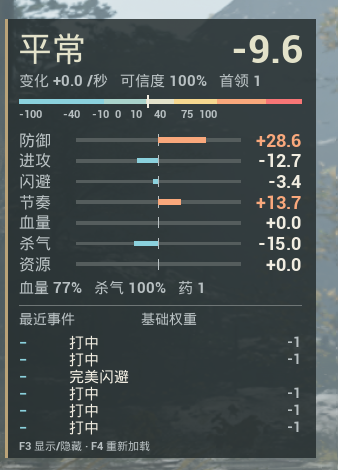

# BossTensionDisplay

[中文](README.md) · [Download v0.1.1](https://github.com/iiiiiie/BossTensionDisplay/releases/tag/v0.1.1)

A read-only boss tension HUD for the Steam version of **Phantom Blade Zero**, built with UE4SS and native UMG widgets. The in-game HUD is currently Chinese.

**This project uses the custom [BossTensionDisplay Source-Available License 1.0](LICENSE), not MIT or an OSI-approved open-source license. Sale is prohibited. No license is granted to the operators/controllers of `wanjiadongli.com` / 玩家动力, the operators/controllers of Bilibili UID `1317077696`, or the representatives, affiliated entities and circumvention parties defined in LICENSE.** Other parties may use, modify and redistribute it subject to attribution, free distribution and source-sharing conditions. The Chinese LICENSE is the controlling text.



## Features

- The game's Raw tension, Tier, rate of change and confidence.
- Seven dimension scores: defense, offense, dodge, rhythm, health, posture and resources.
- Player health/posture ratios, medicine count, and up to six recent events.
- A waiting state and `--` without an active encounter. For multiple bosses, the session with the latest event is selected.

Combat data is read only. The mod does not change tension, AI, character attributes or saves. It creates its own display widgets.

## Installation and controls

1. Install the game-specific [UE4SS for Phantom Blade Zero](https://www.nexusmods.com/phantombladezero/mods/5). This release was verified with prerequisite **1.0.3** and Steam build **26367565**. No prerequisite DLLs or game files are bundled.
2. Close the game and extract `BossTensionDisplay-0.1.1.zip` from the release page.
3. Copy only the **`BossTensionDisplay` folder** into `<GameDirectory>\platform\steam\ue4ss\Mods\`.

The installed paths should include:

```text
<GameDirectory>\platform\steam\ue4ss\Mods\BossTensionDisplay\enabled.txt
<GameDirectory>\platform\steam\ue4ss\Mods\BossTensionDisplay\Scripts\main.lua
```

When using the repository source, copy the same mod folder. Editing `mods.txt` is unnecessary. Restart the game to load it.

| Key | Action |
| --- | --- |
| F3 | Show or hide the HUD |
| F4 | Reload the mod and settings |

To uninstall, close the game and move the whole `BossTensionDisplay` folder out of `Mods`. Keep a copy to restore it later. Renaming the folder while retaining `enabled.txt` may still allow UE4SS to load it.

## Settings

Edit `BossTensionDisplay\Scripts\Settings.lua`, save, then press F4. Changes to key bindings require a game restart.

| Setting | Default | Meaning |
| --- | --- | --- |
| `ToggleKey` / `ReloadKey` | `F3` / `F4` | Visibility and reload keys |
| `RightMargin` / `TopMargin` | `28` / `78` | Right and top margins |
| `Scale` | `1.0` | HUD scale |
| `ShowWhenInactive` | `true` | Show the waiting panel outside encounters |
| `PollMilliseconds` | `200` | Readout update interval in milliseconds |
| `MaxEvents` | `6` | Number of visible events, 0–6 |
| `Diagnostics` | `false` | Read-only reflection diagnostics for interface changes |

## Data limits and validation

Events show positive/negative outcomes and the boss profile's **base weights**. The available `OutcomeRecord` contains time, tag and outcome sign, but no final weighted contribution. These numbers differ from the final contribution values in the reference video; this release does not estimate those values. `DeltaPerSec` and `Confidence` are displayed as returned by the game, not calculated by the mod. The reported rate was often zero during validation.

Tier comes directly from the game; the Chinese state names are translations. Dimension bars cover ±50 and clamp visually outside that range, while the numeric labels keep the actual values.

On November 7, 2026, an encounter with 斧老大·彭猛 was used to verify tension, all seven dimensions, events, death/re-entry, F3 and F4. The retained 34 real samples ranged from **-44.1954 to 100** Raw. The validation log contained no mod runtime errors after the first successful sample. This is evidence for the tested game build, not exhaustive coverage of every boss, device or future version.

For problems after a game update, search the prerequisite's `ue4ss\UE4SS.log` for `[BossTensionDisplay]`. Share only relevant excerpts with private information removed.

## Development and credits

The implementation was created with AI assistance and checked in game as described above. The feature was inspired by [this video](https://www.bilibili.com/video/BV1ae4j6MERe) by 尾巴尾巴啊; the video's mod source was not obtained or copied. Thanks to the UE4SS contributors and the game-specific prerequisite maintainers.

See the repository's [CLAUDE.md](https://github.com/iiiiiie/BossTensionDisplay/blob/main/CLAUDE.md) for project structure and packaging, [CONTRIBUTING.md](https://github.com/iiiiiie/BossTensionDisplay/blob/main/CONTRIBUTING.md) for contributions, and [CHANGELOG.md](CHANGELOG.md) for release notes.

The license is adapted from the maintainer's [`iiiiiie/esp`](https://github.com/iiiiiie/esp/blob/main/LICENSE) project. It grants no rights to third-party game or UE4SS content. Platform terms may independently grant on-platform viewing or forking rights. Public visibility does not grant a project license to the excluded parties; see LICENSE Sections 4 and 5 for the boundary.
