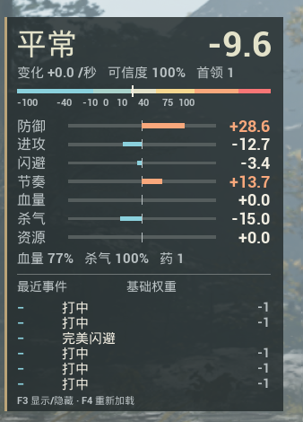

# BossTensionDisplay

[English](README.en.md) · [v0.1.1 下载](https://github.com/iiiiiie/BossTensionDisplay/releases/tag/v0.1.1)

《影之刃零》Steam 版的只读压力显示模组，使用 UE4SS 与游戏内原生 UMG 控件，在右上角显示首领战中的真实压力读数。当前 HUD 为中文。

**本项目采用自定义[源码公开许可证 1.0](LICENSE)，并非 MIT 或 OSI 标准开源许可。禁止售卖，不向 `wanjiadongli.com`／“玩家动力”的运营或控制主体、Bilibili UID `1317077696` 的运营或控制者，以及 LICENSE 定义的代表、关联或规避主体授予许可。** 其他使用者可在遵守署名、免费分发及修改源码公开等条件下使用、修改和再分发。完整条款以 LICENSE 为准。



## 显示内容

- 游戏返回的压力 Raw、状态 Tier、变化率与可信度。
- 防御、进攻、闪避、节奏、血量、杀气、资源七个维度的真实分数。
- 玩家血量／杀气比例、药品数量，以及最近最多六次事件。
- 没有活动首领战时显示等待状态与 `--`；多首领时选取最近产生事件的会话。

只读取战斗数据，不修改压力、AI、角色属性或存档；显示界面由本模组创建。

## 安装与操作

1. 安装游戏专用前置 [UE4SS for Phantom Blade Zero](https://www.nexusmods.com/phantombladezero/mods/5)。本版使用前置 **1.0.3**、Steam build **26367565** 验证，未打包任何前置 DLL 或游戏文件。
2. 退出游戏，下载发行页中的 `BossTensionDisplay-0.1.1.zip` 并解压。
3. 将其中的 **`BossTensionDisplay` 文件夹**复制到 `<GameDirectory>\platform\steam\ue4ss\Mods\`。

安装后应存在：

```text
<GameDirectory>\platform\steam\ue4ss\Mods\BossTensionDisplay\enabled.txt
<GameDirectory>\platform\steam\ue4ss\Mods\BossTensionDisplay\Scripts\main.lua
```

使用仓库源码时也只复制这个模组文件夹。不需要修改 `mods.txt`。重启游戏加载。

| 按键 | 功能 |
| --- | --- |
| F3 | 显示／隐藏面板 |
| F4 | 重载本模组和设置 |

卸载时先退出游戏，再把整个 `BossTensionDisplay` 文件夹移出 `Mods`，保留副本即可恢复。仅改文件夹名而保留 `enabled.txt` 仍可能被 UE4SS 加载。

## 设置

编辑 `BossTensionDisplay\Scripts\Settings.lua`，保存后按 F4。修改快捷键后需要重启游戏。

| 设置 | 默认值 | 说明 |
| --- | --- | --- |
| `ToggleKey` / `ReloadKey` | `F3` / `F4` | 显隐／重载按键 |
| `RightMargin` / `TopMargin` | `28` / `78` | 面板右侧／顶部边距 |
| `Scale` | `1.0` | 面板缩放 |
| `ShowWhenInactive` | `true` | 无首领战时显示等待面板 |
| `PollMilliseconds` | `200` | 读数更新间隔，毫秒 |
| `MaxEvents` | `6` | 显示事件数，可设为 0–6 |
| `Diagnostics` | `false` | 输出只读反射诊断，排查接口变化时使用 |

## 数据边界与验证

事件栏显示正负结果及首领配置中的**基础权重**。当前可读的 `OutcomeRecord` 只有事件时间、标签和正负结果，没有最终加权贡献，因此事件数字与参考视频中的最终贡献值有区别，本版不估算它。`DeltaPerSec` 与 `Confidence` 按游戏返回值显示，未自行计算；验证时变化率经常为零。

Tier 直接读取游戏状态，中文状态名为翻译。分项柱形范围为 ±50，超出时柱形截断，数字仍显示真实读数。

2026年11月7日在“斧老大·彭猛”战斗中验证了压力、七个维度、事件列表、死亡后重新进入，以及 F3／F4。保留的 34 次真实采样中 Raw 为 **-44.1954 至 100**；首次成功采样后的验证日志中没有本模组运行错误。这是该游戏版本下的实战结果，不代表所有首领、设备或后续版本均已验证。

若游戏更新后出现问题，请查看前置目录的 `ue4ss\UE4SS.log`，搜索 `[BossTensionDisplay]`，只提交与问题相关且已去除私人信息的片段。

## 开发与致谢

源码在 AI 辅助下实现，并进行了上述实战核对。功能灵感来自尾巴尾巴啊的[视频](https://www.bilibili.com/video/BV1ae4j6MERe)，未取得或复制视频作者模组的源代码。感谢 UE4SS 贡献者及游戏专用前置的维护者。

目录结构与打包命令见仓库中的 [CLAUDE.md](https://github.com/iiiiiie/BossTensionDisplay/blob/main/CLAUDE.md)，贡献说明见 [CONTRIBUTING.md](https://github.com/iiiiiie/BossTensionDisplay/blob/main/CONTRIBUTING.md)，更新记录见 [CHANGELOG.md](CHANGELOG.md)。

本许可证参照维护者的 [`iiiiiie/esp`](https://github.com/iiiiiie/esp/blob/main/LICENSE) 项目。它不授权第三方游戏或 UE4SS 内容。GitHub 等平台的服务条款可能独立授予站内查看、fork 等权利；公开可见不等于本项目向被排除主体授予使用许可，具体边界见 LICENSE 第4、5条。
